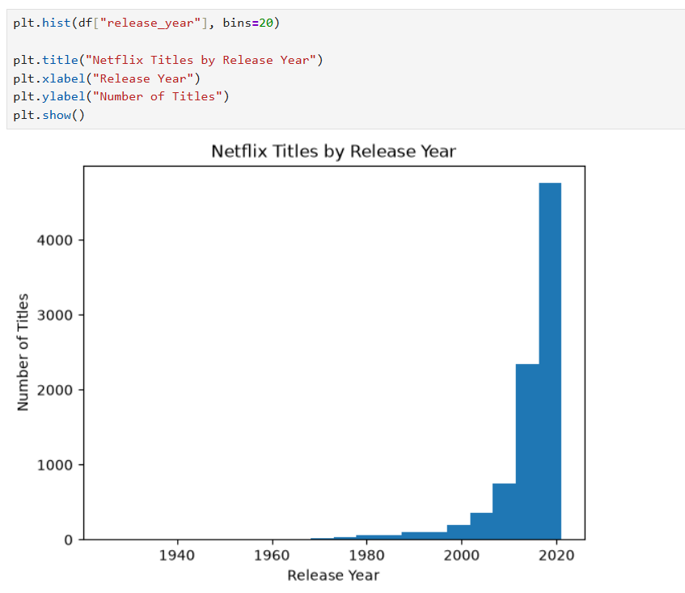

# 🎬 Netflix Data Analysis Using Python

## 📌 Project Overview
This project focuses on analyzing Netflix movies and TV shows using Python. The dataset is explored to understand the content available on Netflix.

## 🎯 Project Objectives
- Explore the Netflix dataset.
- Understand the data using Pandas.
- Perform basic data analysis.
- Identify patterns in Netflix movies and TV shows.

## 🛠️ Tools & Technologies
- Python
- Jupyter Notebook
- Pandas
- NumPy
- Matplotlib

## 📂 Project Files
- `netflix py.ipynb` – Jupyter Notebook containing the analysis.
- `netflix_titles.csv` – Dataset used for the project.

## 🚀 How to Run
1. Download the project files.
2. Open Jupyter Notebook.
3. Open `netflix py.ipynb`.
4. Make sure the CSV dataset is in the correct folder.
5. Run the notebook cells in order.

## 📊 Project Visualizations

.png)
